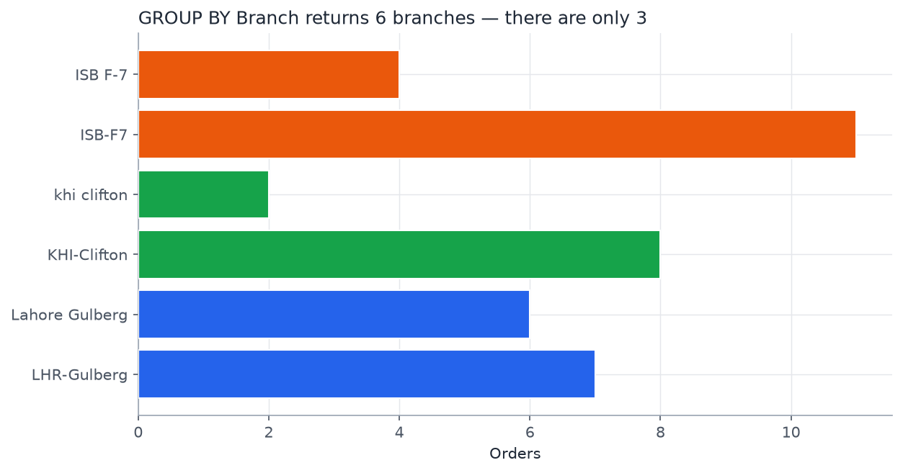
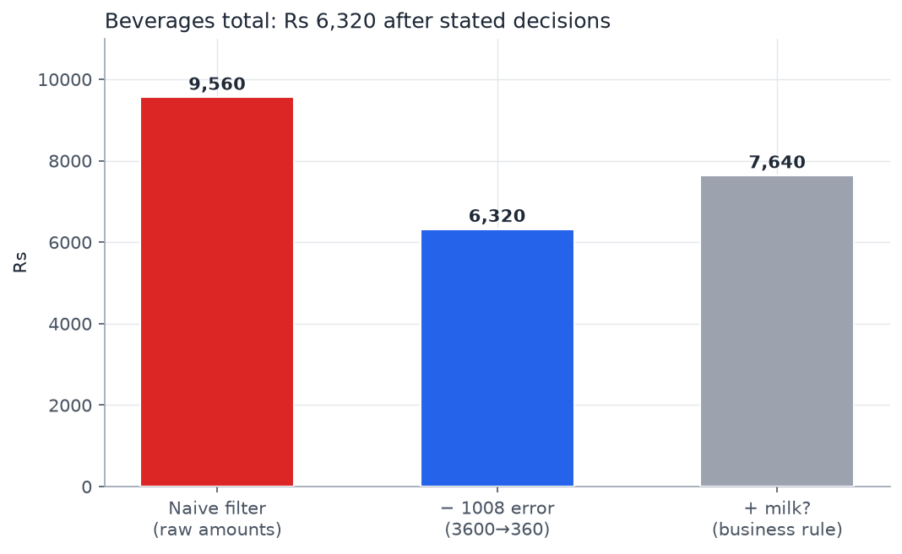
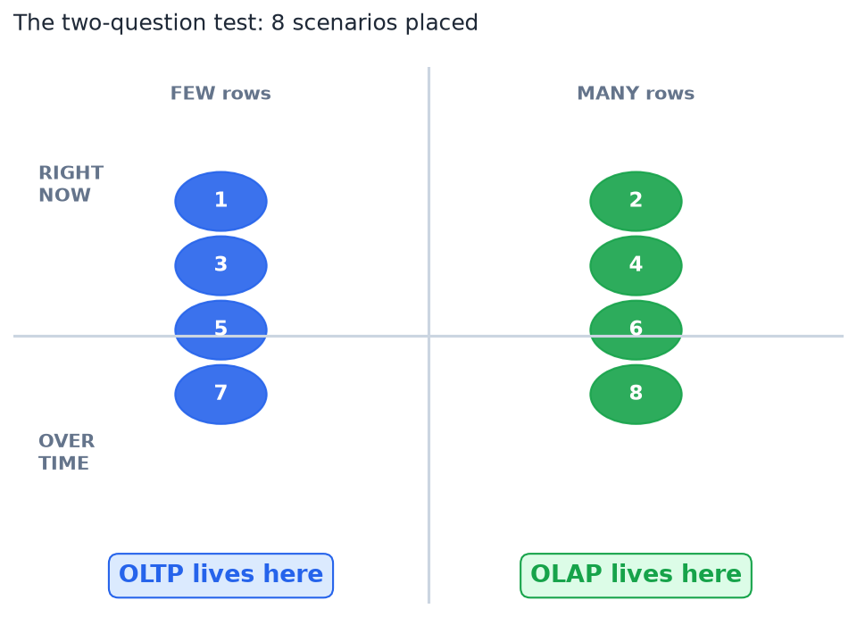
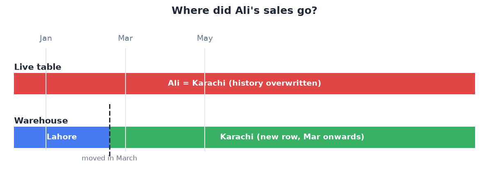
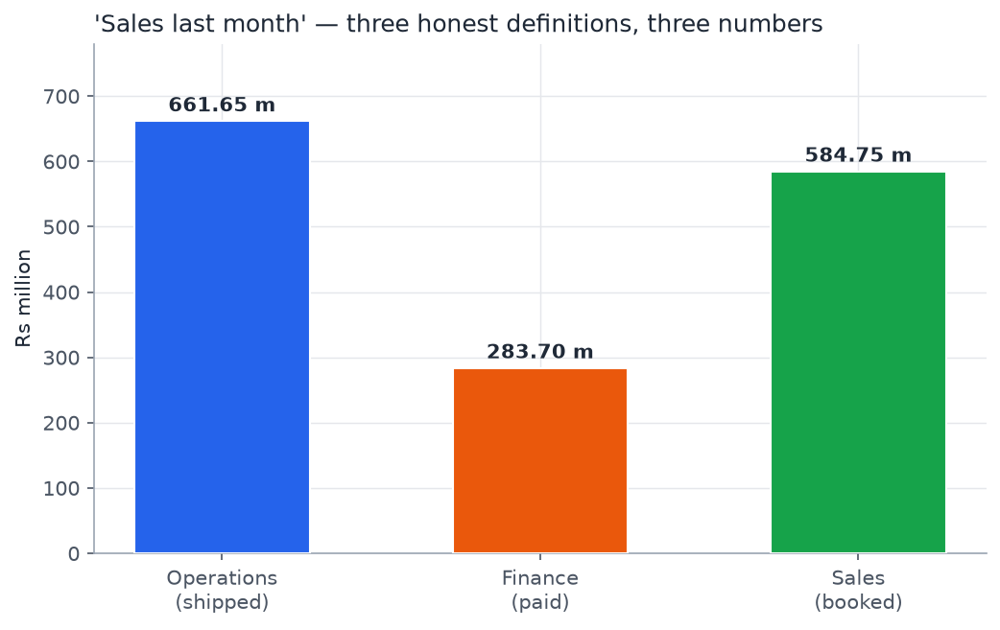
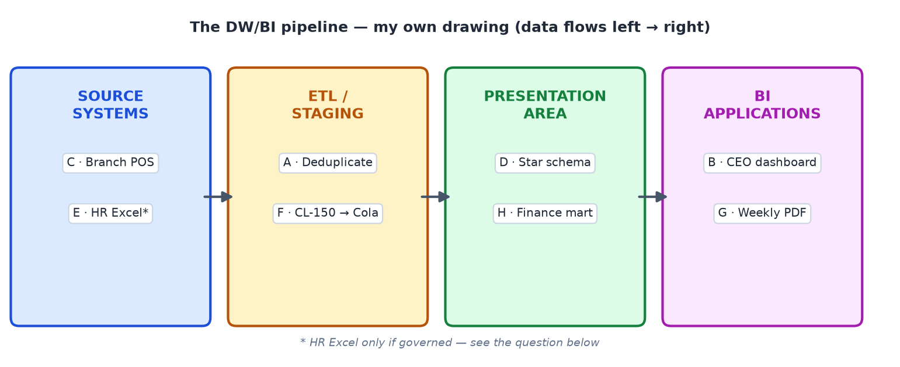
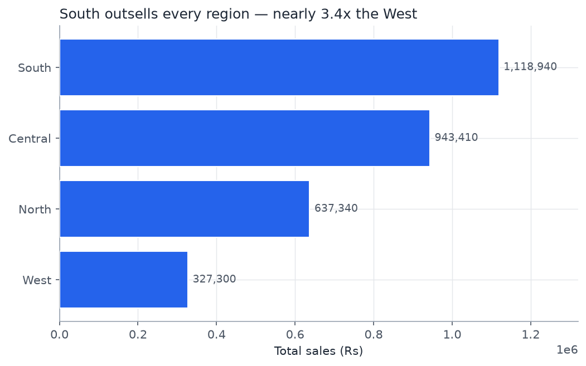
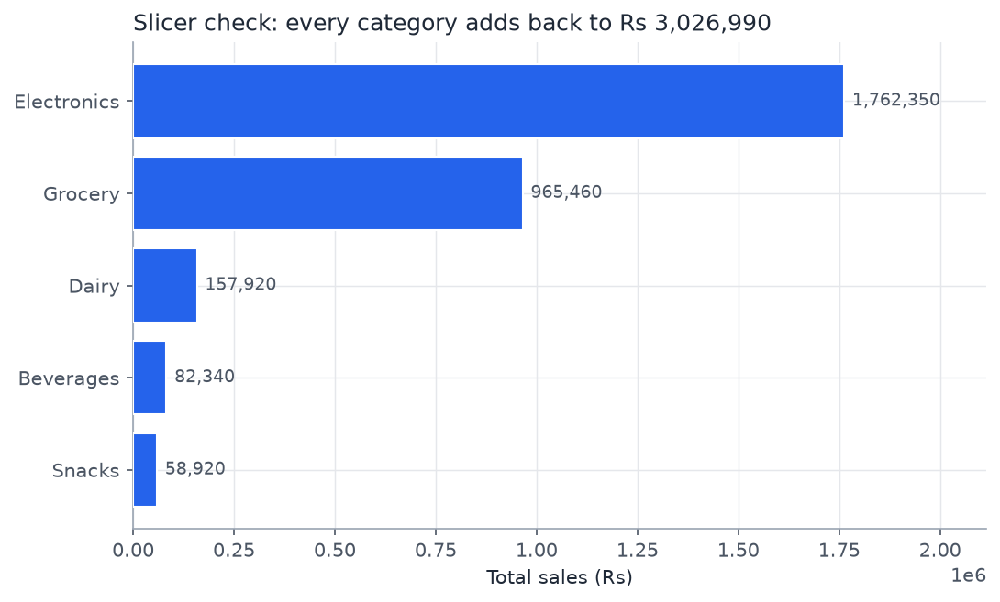
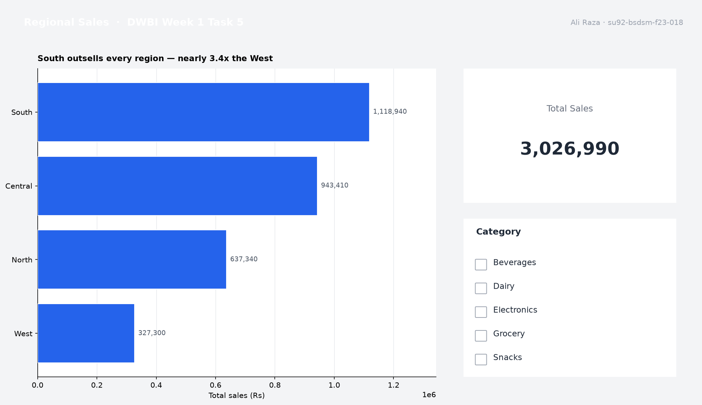

# Week 1 — Introduction to DW & BI
## Analysis Report

**Ali Raza** · Roll No: **su92-bsdsm-f23-018** · Section: **BSDS-7A**
Course: Data Warehouse & BI — Week 1 Assignments

---

## 1. Overview

Five tasks covering Lecture 1 (fundamentals: why a warehouse exists) and Lecture 2 (first live Power BI
connection). Each task is one fully executed Jupyter notebook with the analysis, the numbers, and the
reasoning — every claim carries its evidence, every data problem names its owner, every decision is stated.

```bash
cd week1/assignments
pip install pandas numpy matplotlib jupyter openpyxl
jupyter notebook task1.ipynb   # … task5.ipynb
```

> All data is synthetic, generated for the course (`SEED = 42`, unchanged).

## 2. Datasets

| File | Rows | Content |
|---|---|---|
| `data/DWBI_W1_Messy_Sales_Log.csv` | 38 | One morning's orders, deliberately dirty — Task 1 |
| `data/DWBI_W1_Regional_Sales.xlsx` | 480 / 15 / 4 | Sales (fact) / Products / Regions — Task 5, clean by design |

---

## 3. Task 1 — The messy sales log ([task1.ipynb](task1.ipynb))

**Eight problems found** (task asked for six), each with an `OrderID`, why it breaks a report, and its owner:

| # | Problem (`OrderID`) | Report breakage | Owner |
|---|---|---|---|
| 1 | Branch written 4 ways (`1002`: `Lahore Gulberg` vs `LHR-Gulberg`) | `GROUP BY` returns 6 branches, not 3 | ETL — conform to one branch dimension |
| 2 | Five date formats (`1004`: `12 Sep 26`) | parsing fails; `09-12-2026` is ambiguous | ETL — parse to one ISO date |
| 3 | Duplicated order (`1004` × 2) | every total double-counts it | Source system — unique order key |
| 4 | One product, three names (`1002`: `CL-150`) | Cola's sales fragment across 3 "products" | ETL — alias → canonical SKU map |
| 5 | Blank category (`1005`, `1033` — milk) | rows vanish from category reports | The business — only a human can rule what milk *is* |
| 6 | Amounts as text (`1002`: `Rs 180`, `1006`: `"2,450"`) | naive `SUM` silently skips rows | ETL — store real numbers |
| 7 | Return as negative row (`1007`) | gross vs net depends on an unwritten rule | The business — define "revenue" once |
| 8 | Decimal-point error (`1008`: 3600 vs `1001`: 360) | one keystroke inflates Beverages by Rs 3,240 | Source system — validate vs price master |

**The Beverages total — Rs 6,320** (Rs 7,640 if the business rules milk a beverage). Working: deduped
`1004`, corrected `1008` → 360 (all 7 cola rows prove unit price 180), kept the return as recorded,
excluded blank-category milk pending a business rule. **Confidence: medium** — needs the milk rule and
branch confirmation of `1008`.

**Preventable at data entry:** branch spellings (dropdown, not free text) and product names (barcode scan).

**Why no dashboard:** it would show six branches, mis-sum text amounts, and double-count `1004` — every
number wrong, with no warning.




---

## 4. Task 2 — OLTP or OLAP? ([task2.ipynb](task2.ipynb))

All eight scenarios classified with the two-question test (*how many records? right now or over time?*):
cashier/ATM/rider/phone-update → **OLTP** (one row, right now); CEO 12-month comparison, Eid-week
analysis, 3-month balance pattern, branch ranking → **OLAP** (millions of rows, over time).

Plus two own scenarios (Lahore bakery chain), one borderline case ("today's sales so far at 3pm" —
argued both sides, placed on **OLAP**: an aggregation over time is still a scan), and the precise reason
the CEO's report slowed the tills: long analytical scans take shared locks and flood the buffer pool, so
every cashier's write queues behind them — OLTP is tuned for fast writes, and the report stole exactly
what writes need.



---

## 5. Task 3 — No history, and no single truth ([task3.ipynb](task3.ipynb))

- **Ali's sales:** breaks Inmon's **time-variant** property. The warehouse keeps slowly-changing-dimension
  rows (Ali–Lahore valid Jan–Feb, Ali–Karachi from March) so last year's report still credits Lahore.
  Same failure class: overwriting a product's price rewrites revenue history.
- **Three departments, three numbers:** Operations counts *shipped*, Finance counts *paid*, Sales counts
  *booked* — three honest definitions, no arithmetic error. One staging area makes them three *views*
  over one governed definition. The definition is owned by a **business data-governance group**, not IT
  and not any single department.
- **Why a warehouse at all:** your systems already forget (no history) and already disagree (no single
  truth) — the warehouse fixes exactly those two things.
- **"Non-volatile", properly:** data is never *updated in place*; corrections arrive as new rows.
  Legitimate change: repairing a corrupted ETL load (with audit), not rewriting business history.




---

## 6. Task 4 — The DW/BI architecture ([task4.ipynb](task4.ipynb))

Eight items placed, two per stage: Source Systems (C branch POS, E HR Excel); ETL/Staging (A dedupe,
F `CL-150`→Cola); Presentation Area (D star schema, H finance mart); BI Applications (B CEO dashboard,
G weekly PDF). Diagram **drawn by hand in code** (no slide screenshot):



Restaurant metaphor extended: diner in the kitchen = querying source systems directly (Task 2's
slowdown); kitchen serving untasted = loading without validation (`1008`'s Rs 3,600); two kitchens,
two recipes = no single staging (Task 3's three numbers). Three Kimball goals with Superstore
violations each. HR Excel: accepted as a source **only** with a named owner, versioned drops, declared
schema, and staging validation.

---

## 7. Task 5 — First live connection ([task5.ipynb](task5.ipynb))

Pre-load questions answered: `Sales.ProductID` identifies the product; `RegionName` lives in `Regions`;
the Category slicer must come from `Products` (`Sales` has no `Category`).

Verified in code: **480 / 15 / 4 rows**; relationships `Products 1→* Sales` and `Regions 1→* Sales`
(one side = unique key); **Total Sales by Region: South 1,118,940 > Central 943,410 > North 637,340 >
West 327,300**; all four validations pass (card = 3,026,990 = category slicer sum = source sum; 0
nulls; source file untouched). `UnitPrice` is identical in both tables — report uses verified
`SalesAmount`; `Products.UnitPrice` is the price master.




**Report page** (`DWBI_W1_su92-bsdsm-f23-018.pbix`, page "Regional Sales"):



Power BI steps for the `.pbix` are documented in the notebook (Get Data → Model view → bar + card +
slicer → save as `DWBI_W1_su92-bsdsm-f23-018.pbix`). Why it took a minute: the question ran on an
**OLAP-shaped star schema**, not the live checkout DB — no locks on any till (Task 2's lesson).

---

## 8. Marking-guide compliance

| Criterion | Weight | How it is met |
|---|---|---|
| Accuracy | 30% | every problem has an OrderID; totals computed with working; validations reconcile |
| Logic | 30% | each owner justified in a sentence; decisions stated with their effect on the total |
| Application | 25% | 480/15/4 confirmed; both relationships verified; 4 validations pass |
| Creativity | 15% | own scenarios, own diagram, finding-titles |

**Automatic deductions avoided:** nothing copied from slides; every problem demonstrated; total with
working; `RegionName` not `RegionID`; card reconciles; own diagram; seed unchanged.

## 9. Files

| File | What it is |
|---|---|
| [task1.ipynb](task1.ipynb) … [task5.ipynb](task5.ipynb) | Fully executed notebooks: analysis, numbers, reasoning |
| [data/](data/) | `DWBI_W1_Messy_Sales_Log.csv`, `DWBI_W1_Regional_Sales.xlsx` |
| [charts/](charts/) | `t4_architecture.png`, `t5_sales_by_region.png`, `t5_category.png`, `t5_report_page.png`, `t1_branches.png`, `t1_beverages.png`, `t2_oltp_olap.png`, `t3_history.png`, `t3_three_numbers.png` |
| `DWBI_W1_su92-bsdsm-f23-018.pbix` | The Task 5 report file — 3 tables, 2 relationships, "Regional Sales" page (bar + card + slicer) |

**Still to do by hand:** Task 5's `.pbix` + report-page screenshot need Power BI Desktop/Service
(Windows or browser) — steps are in `task5.ipynb`.
