# DWBI Week 2 — DW Lifecycle & Architecture

**Ali Raza** · Roll No `su92-bsdsm-f23-018` · **BSDS-7A**

Case: **PakFreight** — three transport modes, three files, three totals, zero trust. The week ends with one trusted table.

## Deliverables

| File | What it is |
|---|---|
| [`task1.ipynb`](task1.ipynb) … [`task5.ipynb`](task5.ipynb) | Executed notebooks (outputs embedded), one per task |
| [`PakFreight_Activity_su92-bsdsm-f23-018.xlsx`](PakFreight_Activity_su92-bsdsm-f23-018.xlsx) | Task 3 workbook — every yellow cell filled, every check ✔ |
| [`DWBI_W2_su92-bsdsm-f23-018.pbix`](DWBI_W2_su92-bsdsm-f23-018.pbix) | Task 4 report file — `Shipments` (34 × 8, 578,650 kg), Validation page |
| [`charts/`](charts/) | All report graphics (14 PNGs + 4 Mermaid sources) |
| [`data/`](data/) | The three source files + the student workbook template |

## Diagram & chart index

Every visual in this report, with its source:

| # | Chart | Task | Source |
|---|---|---|---|
| 1 | [Three tiers](charts/t1_tiers.png) | 1 | drawn in code |
| 2 | [Independent vs dependent marts](charts/t1_marts.png) | 1 | drawn in code |
| 3 | [Inmon CIF](charts/t2_inmon.png) | 2 | drawn in code |
| 4 | [Kimball bus architecture](charts/t2_kimball.png) | 2 | drawn in code |
| 5 | [Kimball lifecycle flowchart](charts/t2_lifecycle.png) | 2 | [Mermaid source](charts/t2_lifecycle.mmd) |
| 6 | [Four totals — the Stovepipe Game](charts/t3_stovepipes.png) | 3 | drawn in code |
| 7 | [Lineage of 578,650 kg](charts/t3_lineage.png) | 3 | drawn in code |
| 8 | [Kimball bus matrix](charts/t3_busmatrix.png) | 3 | drawn in code |
| 9 | [Applied Steps — rail_stg](charts/t4_applied_steps.png) | 4 | Power Query steps |
| 10 | [Data profiling & quality](charts/t4_profiling.png) | 4 | profiled from staged data |
| 11 | [Validation report](charts/t4_validation.png) | 4 | `.pbix` validation page |
| 12 | [Lineage of 578,650 kg](charts/t5_lineage.png) | 5 | [Mermaid source](charts/t5_lineage.mmd) |
| 13 | [Latency decision flowchart](charts/t5_latency.png) | 5 | [Mermaid source](charts/t5_latency.mmd) |
| 14 | [Schema drift flowchart](charts/t5_drift.png) | 5 | [Mermaid source](charts/t5_drift.mmd) |

> The Mermaid diagrams can be opened and edited at [mermaid.live](https://mermaid.live) — paste the `.mmd` source to re-render.

## The one number everything must agree on

**578,650 kg = 578.65 t** — Marine 206,500 + Rail 295,250 + Road 76,900.

---

## Task 1 — The three tiers, and what a warehouse must be

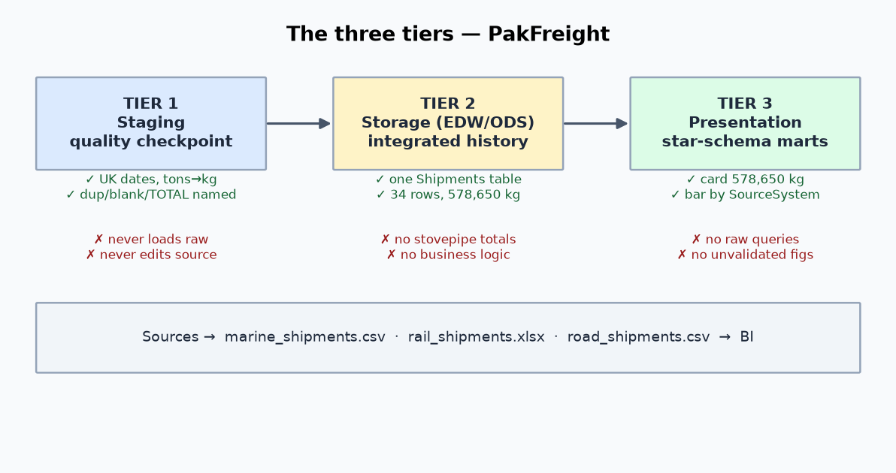

- **Tier 1 Staging** (quality checkpoint): UK-locale dates, tons × 1000, `RL-` prefix, named row removals. Never edits sources, never passes unvalidated data on.
- **Tier 2 Storage** (EDW/ODS): one `Shipments` table, 34 × 8, 578,650 kg — no stovepipe totals, no report formatting.
- **Tier 3 Presentation**: card 578,650, bar by SourceSystem, status counts — no raw queries visible.

Inmon's four properties on PakFreight: *subject-oriented* (one Shipments subject vs three file-centric marts);
*integrated* (one 8-column contract vs tons/kg, three date forms, three casings); *time-variant* (keep every
ShipDate vs overwriting an address — history destroyed); *non-volatile* (never edit the CSV in Excel — evidence destroyed).

EDW vs ODS: dispatcher positions → **ODS**; CFO 3-year cost/tonne → **EDW**; consignment-45017-today → **ODS**; board profitability since 2023 → **EDW**.

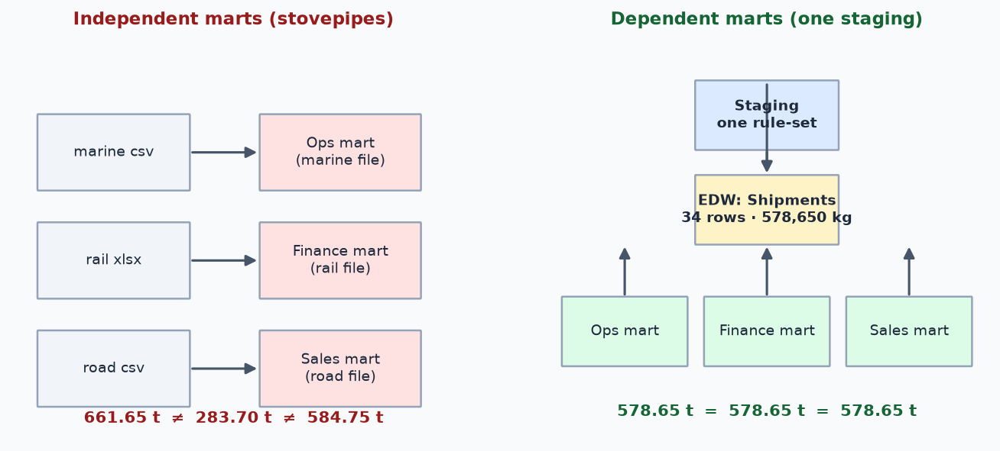

Independent marts (each team straight from its own file) inherit private assumptions — TOTAL row kept, tons read as kg,
duplicate kept — so one question gets 661.65 t ≠ 283.70 t ≠ 584.75 t. Dependent marts (one staging, one EDW, marts derived)
give 578.65 t = 578.65 t = 578.65 t. Raw files pass through staging because that is where every fix is recorded —
without it, a wrong number can never be traced to its file, row and transformation.

**Q:** overwriting an address breaks **time-variant** — use a slowly changing dimension (Type 2) instead.

## Task 2 — Inmon, Kimball, and the lifecycle

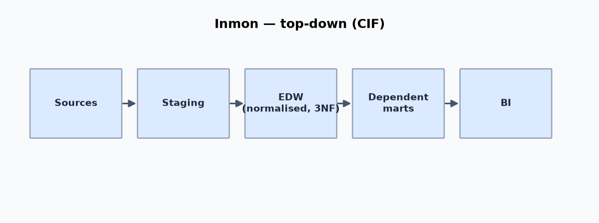
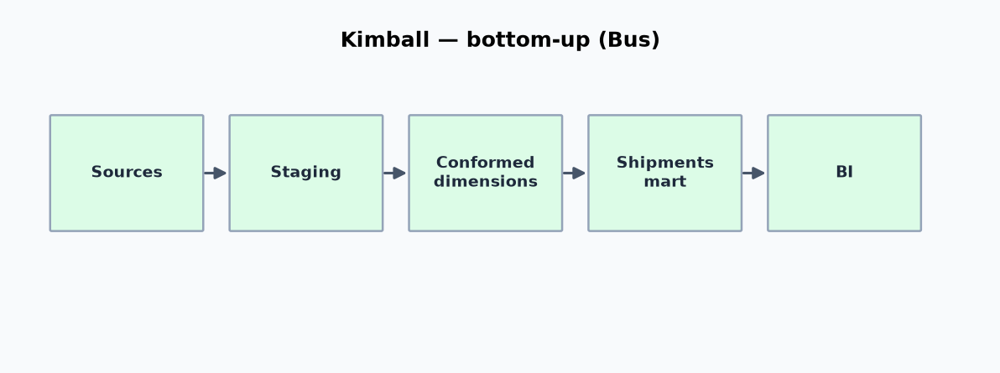

Inmon builds the normalised enterprise warehouse first (slow, governed, dependent marts); Kimball builds one
dimensional mart first (fast, conformed dimensions via the bus, risk of drifting stovepipes). Ten scenarios
classified in the notebook — e.g. the 40-system bank → Inmon; the 6-week startup dashboard → Kimball;
bronze→silver→gold lakehouse → Hybrid. Kimball lifecycle on Iteration 1: requirements (one agreed question),
dimensional modelling (grain = one shipment; conformed Date, Route), ETL (three `_stg` queries → append),
BI app (validation page), deployment (hide `_stg`, schedule Refresh).

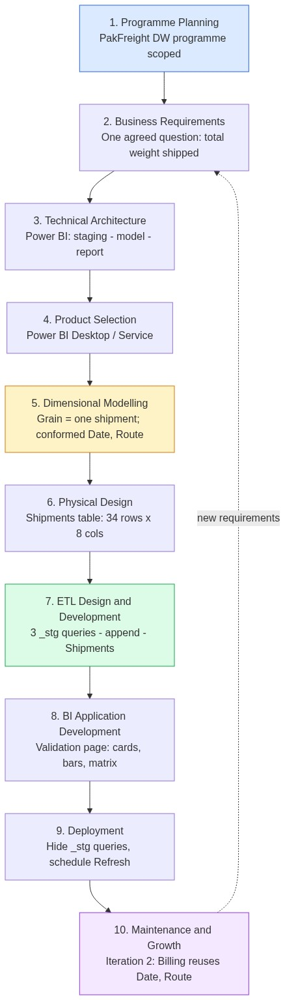

Mermaid source code — Kimball lifecycle flowchart

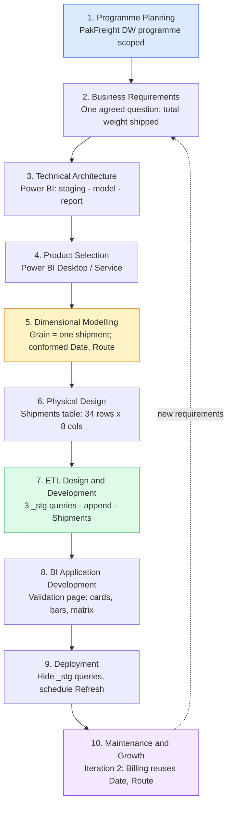

*File: [`charts/t2_lifecycle.mmd`](charts/t2_lifecycle.mmd) · edit at [mermaid.live](https://mermaid.live)*

Iteration 2 (Billing) reuses conformed
**Date** and **Route** — "conformed" = same dimension, same keys, same meaning in every mart. SDLC is
requirements → program; CLDS is data → requirements — nobody required "handle rail's title rows" until someone
opened the file and found them.

**Q:** "Shipments mart first with conformed Date and Route" is **bottom-up**; top-down would have required the
enterprise model to exist first.

## Task 3 — Data Detective

Twelve problems logged across all three files (units, dates, IDs, casing, whitespace, duplicates, blanks,
non-data rows, missing values, column names). The Stovepipe Game reproduced arithmetically:

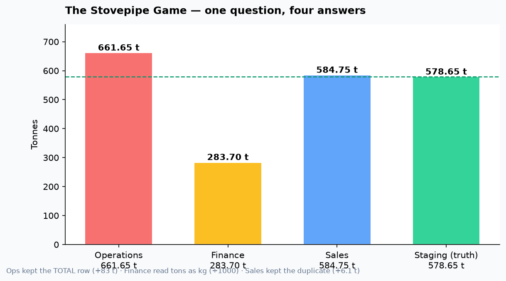

- **Operations 661.65 t** = 206,500 + 295,250 + (76,900 + 83,000) — removed the duplicate, kept the TOTAL row
- **Finance 283.70 t** = 206,500 + 295.25 + 76,900 — road cleaned, rail tons read as kilograms
- **Sales 584.75 t** = 206,500 + 295,250 + (76,900 + 6,100) — removed the TOTAL, kept the duplicate
- **Staging 578.65 t** — the truth

All three teams were honest; each summed their own file under private assumptions, with no shared staging to contradict them.
The workbook stages all three with formulas (RAW untouched), reconciles 12/10/12 rows and 206,500/295,250/76,900 kg —
every check ✔, date trap MR-1003 = 03-Feb-2026 ✔.

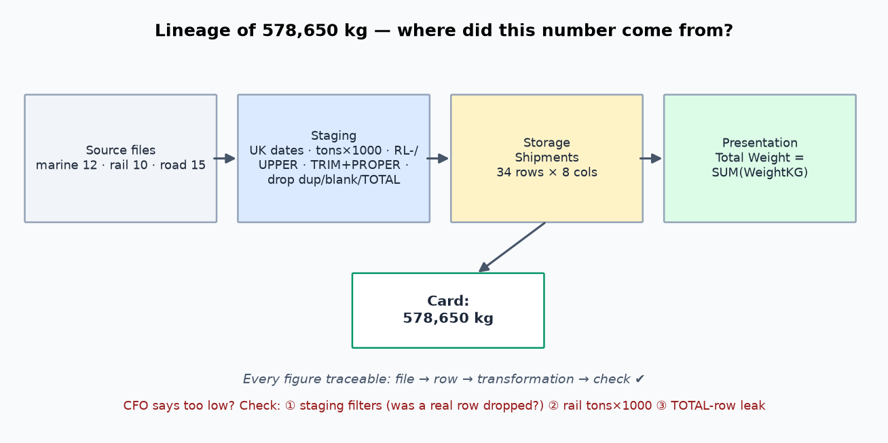

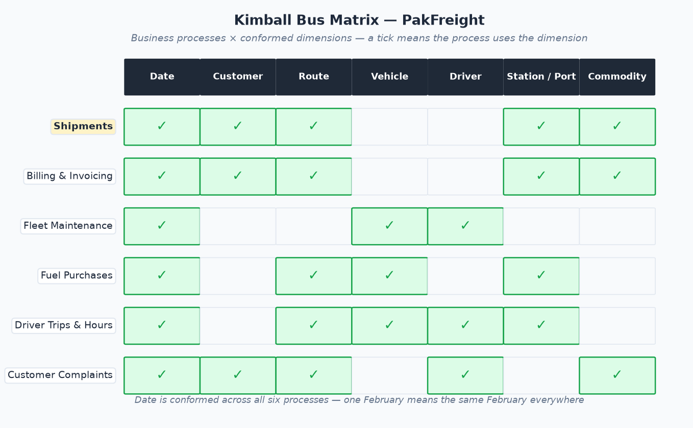

**Q:** one control so a TOTAL row can never reach a report — a row-type guard in staging (reject null/blank/`TOTAL`
IDs) plus a reconciliation check that fails the load when staged rows ≠ raw − named removals.

## Task 4 — Hands-on: one pipeline in Power BI

Transform-not-Load (fixes become recorded steps before anything touches the model) → `marine_stg` / `rail_stg` /
`road_stg` → rail headers fixed (title block deleted, not data) → contract column names → UK dates, tons × 1000,
`RL-` prefix, UPPER road IDs, TRIM + PROPER status → named row removals → append → `Shipments`, `_stg` hidden.

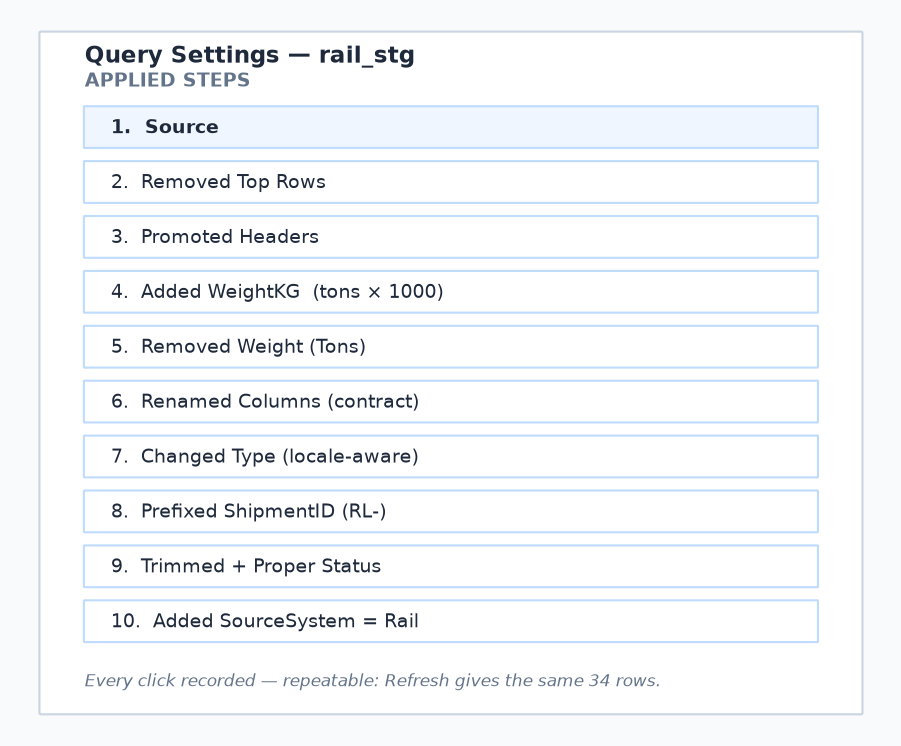
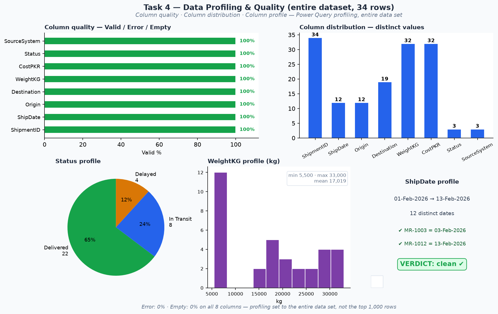
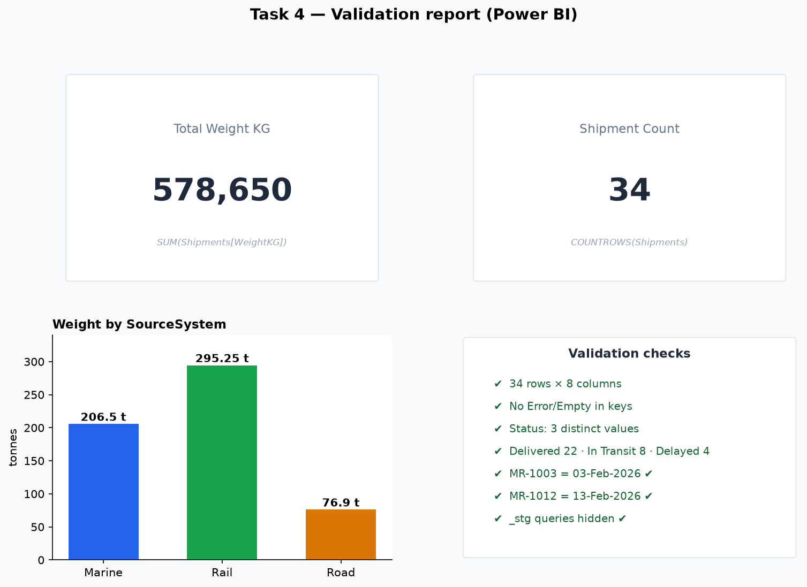

Validated: 34 × 8, no nulls in keys, 3 statuses, card 578,650, by-source 206.5 / 295.25 / 76.9 t, 22 / 8 / 4.
The annotated `rail_stg` M code is in `task4.ipynb`. Disabling load keeps staging *staging* — had the raw queries
stayed loaded, users could have built reports on the dirty files and recreated the stovepipe inside Power BI.

## Task 5 — Latency, drift, lineage and the people

Latency matches the decision clock: dispatcher → real-time; CFO monthly → daily batch; customer tracking →
near-real-time; board quarterly → weekly/batch. "Always real-time" costs infrastructure money and skips the staging
quality checkpoint.

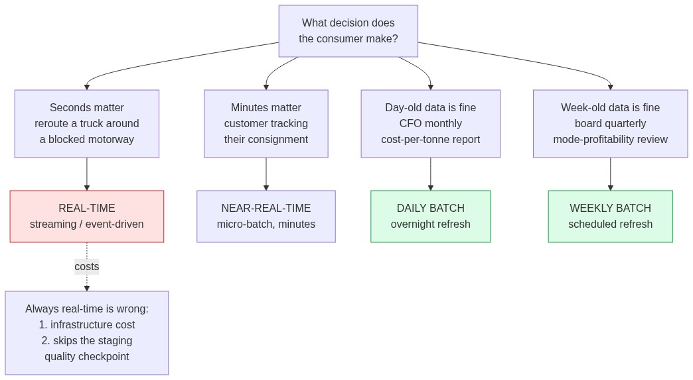

Mermaid source code — Latency decision flowchart

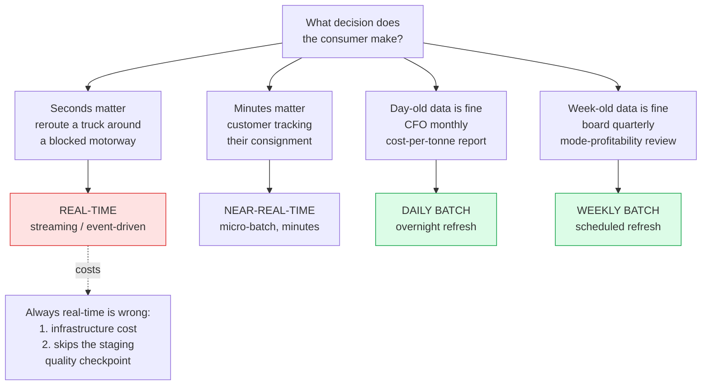

*File: [`charts/t5_latency.mmd`](charts/t5_latency.mmd) · edit at [mermaid.live](https://mermaid.live)*

Schema drift: added `Wagon_Type` is silently dropped (detect via source-vs-contract column check);
renamed `Freight Charges (PKR)` breaks refresh loudly (detect via the same check + a Refresh smoke test).

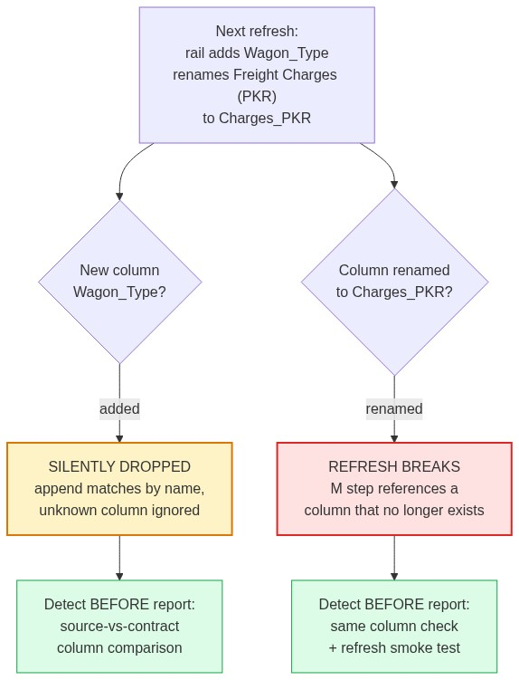

Mermaid source code — Schema drift flowchart

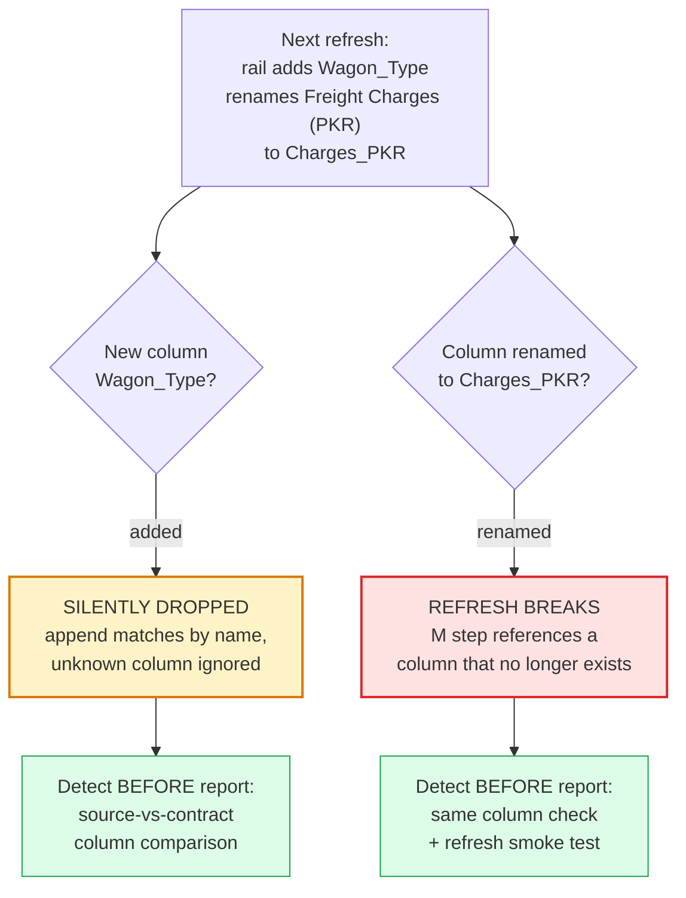

*File: [`charts/t5_drift.mmd`](charts/t5_drift.mmd) · edit at [mermaid.live](https://mermaid.live)*

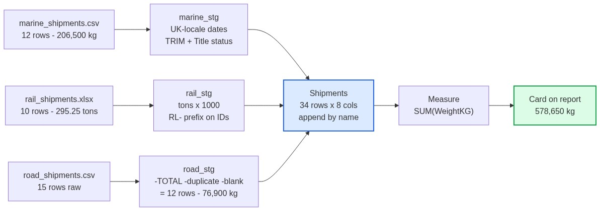

Mermaid source code — Lineage of 578,650 kg

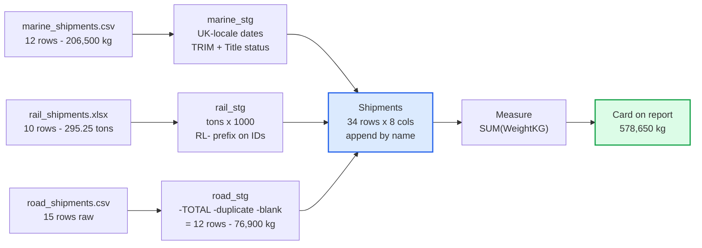

*File: [`charts/t5_lineage.mmd`](charts/t5_lineage.mmd) · edit at [mermaid.live](https://mermaid.live)*

Lineage above; CFO says "too low" → check ① staging filters, ② rail tons × 1000, ③ TOTAL-row guard, in that order.
Roles: architect → storage/presentation; ETL engineer → staging; steward → definitions; BI developer → dashboards;
source owner → export format. Nobody owning staging is exactly how Task 3's three totals happened.

**Q:** unreproducible dashboard → lineage first (does the chain break?), then drift (what changed since it was built?),
then latency (is the "difference" just a different refresh moment?).

---

## Marking-guide mapping

| Criterion | Where it is satisfied |
|---|---|
| Accuracy (30%) | All figures verified in code: 578,650; 661.65 / 283.70 / 584.75; 22 / 8 / 4; workbook checks ✔ by formula engine |
| Logic (25%) | Tier/property/scenario reasoning justified per case; lineage fully traced |
| Application (30%) | Staged pipeline, `_stg` hidden, repeatable Refresh; `.pbix` validated by read-back |
| Creativity (15%) | All diagrams drawn in code; M code annotated in own words; own PakFreight examples |

## Assumptions

- One shipment = one row; duplicates defined on `ShipmentID`, keep first.
- Rail tons → kg is exact (× 1000); no rounding in weights.
- "Delivered / In Transit / Delayed" after TRIM + PROPER is the canonical status set.
- The `.pbix` was generated from the staged result on Linux (no Power BI Desktop); the three `_stg`
  staging tables are hidden in the file and only `Shipments` is visible in the model — the same result
  as Enable-load-off in Power BI Desktop.
