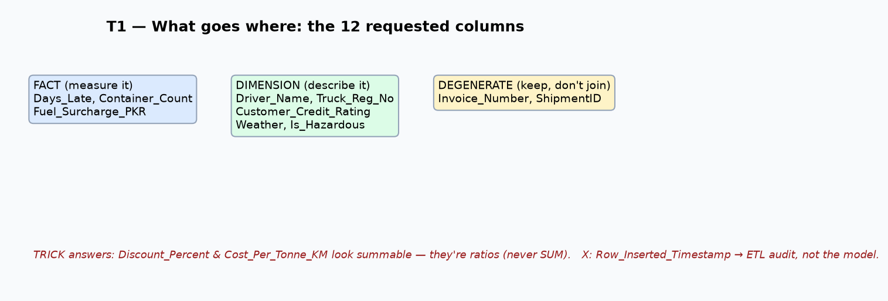
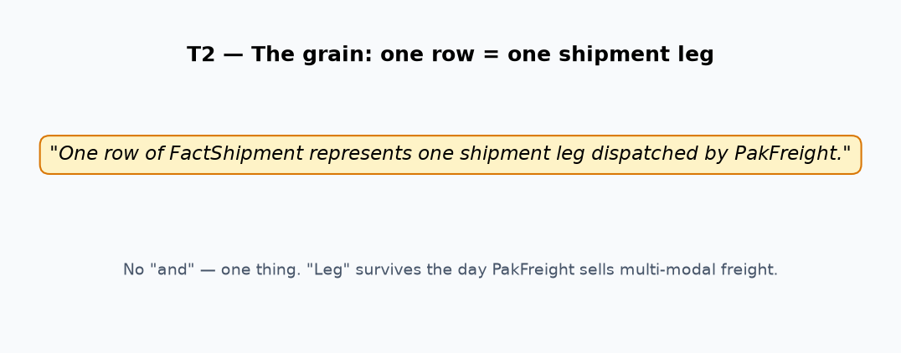
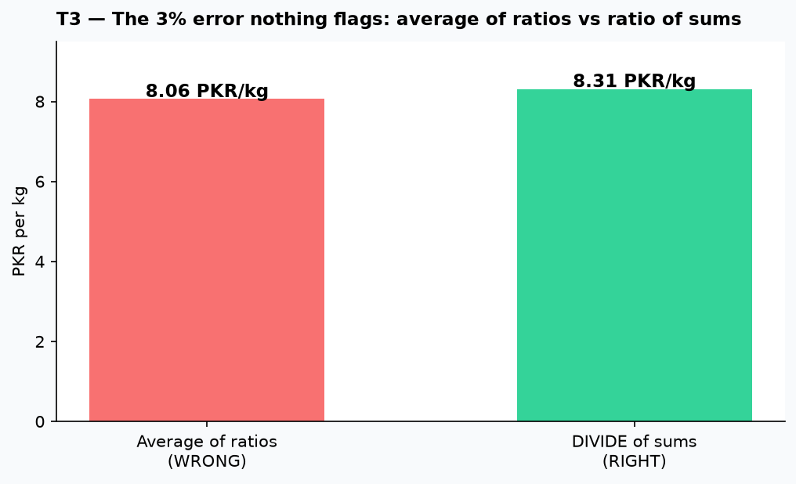
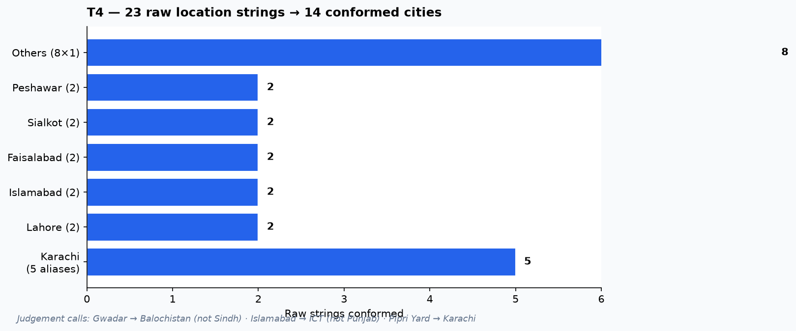
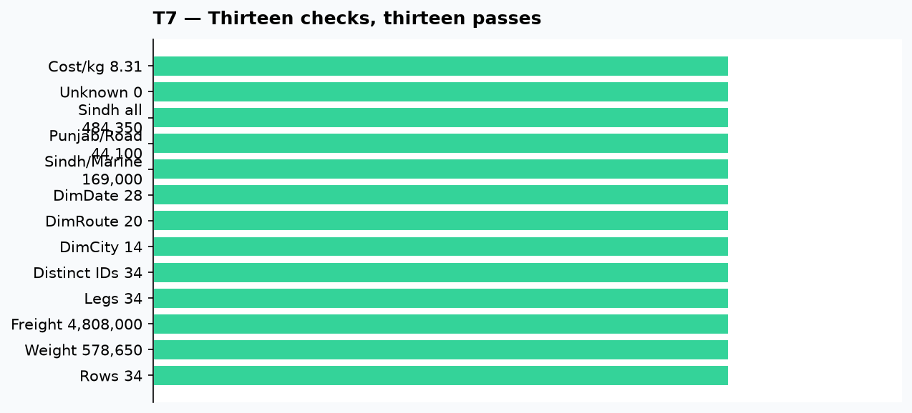
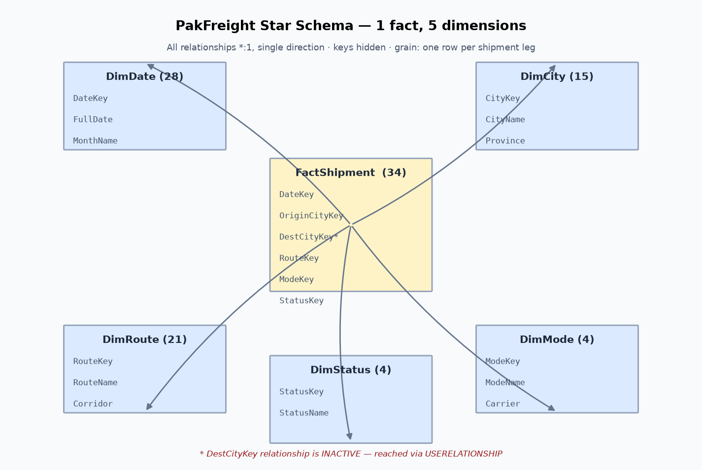
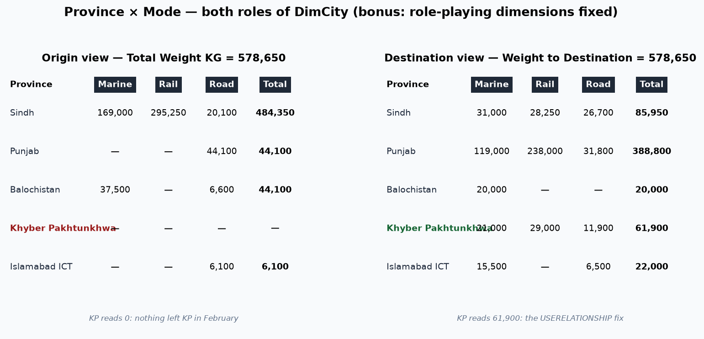

# DWBI Week 3 — Fact & Dimension Tables

**Ali Raza** · Roll No `su92-bsdsm-f23-018` · **BSDS-7A**

PakFreight's flat `Shipments_Unified` (34 rows, 578,650 kg, PKR 4,808,000) becomes
**one fact table + five dimensions** — and the totals do not move by a single kilogram.

## Deliverables

| File | What it is |
|---|---|
| `T1.ipynb` … `T7.ipynb` | Executed notebooks (outputs embedded), one per task |
| `PowerBI_Lab_Guide.ipynb` | The lab: star schema build, measures, validation, bonus |
| `W3_Star_Team.xlsx` | Completed workbook — all 7 tasks, **T7 reads 13 / 13** |
| `W3_su92-bsdsm-f23-018.pbix` | Star schema: 6 tables, 6 relationships (1 inactive), 5 measures |
| `data/` | Source files, built dimension CSVs, star schema + matrix visuals |
| `charts/` | Report graphics, one per task |

**Grain:** one row of FactShipment = one shipment leg dispatched by PakFreight.

---

## T1 — Fact, dimension, degenerate or drop? → [`T1.ipynb`](T1.ipynb)

Twelve verdicts with one-line justifications (workbook sheet T1): facts are numbers that happened
(`WeightKG`, `Days_Late`), dimensions are text that describes (`Driver_Name` → new DimDriver),
degenerates are operational IDs with no table (`Invoice_Number`, `ShipmentID`), and
`Row_Inserted_Timestamp` is **X** — ETL audit metadata, not a dimensional column at all.
The four traps: `Discount_Percent` and `Cost_Per_Tonne_KM` *look* summable but are ratios —
never SUM them; `Truck_Registration_No` looks degenerate but is a real entity (→ DimVehicle).

## T2 — Declare the grain → [`T2.ipynb`](T2.ipynb)

Part A: *"One row of FactShipment represents one shipment leg dispatched by PakFreight."*
"Leg", not "shipment" — the day PakFreight sells multi-modal freight, "one row per shipment"
turns ambiguous, and today's grain is what the CFO's 2027 reports rest on. Part B: four new
processes grained (fuel = transaction; driver days = periodic snapshot; complaints = transaction +
**bridge table** for multi-shipment complaints; warehouse stock = periodic snapshot). Part C:
the analyst who duplicated a row broke the grain — T7 checks 2 and 4 catch it instantly.

## T3 — Additivity audit → [`T3.ipynb`](T3.ipynb)

Ten measures classified: additive (`WeightKG`), semi-additive (snapshots like `WarehouseStockKG`),
non-additive (every ratio). The proof from PakFreight's own 34 rows: averaging per-row
`Cost/Weight` gives **8.06**, `DIVIDE(SUM(cost), SUM(weight))` gives **8.31** — a 3% error with no
red cell anywhere. The board slide gets 8.31; the 8.06 measures the average *shipment's* cost per kg,
a real quantity answering a different question. `AverageWeightPerShipment`: delete the column —
store the numerator and denominator, never the ratio.

## T4 — Build DimCity → [`T4.ipynb`](T4.ipynb)

23 raw strings → 14 conformed cities, surrogate keys 1–14 minted by hand, plus the **`-1` Unknown** row.
Judgement calls defended: Gwadar → **Balochistan** (not Sindh — else Sindh/Marine reads 206,500);
Islamabad → **ICT** (not Punjab — else Punjab/Road reads 50,200); Pipri Marshalling Yard → Karachi
(a 40 km decision that quietly commits the yard's capacity to every "Karachi" plan). New spelling next
month: lookup fails → `-1` Unknown (visible, countable) → conformer maps it → refresh. Never hand-edit the fact.

## T5 — The other four dimensions → [`T5.ipynb`](T5.ipynb)

**The Block A trap:** deduping raw Origin→Destination pairs gives **30** rows, because
`Karachi Port → Lahore Dry Port` and `Port Qasim → Lahore Dry Port` are different strings for the
same conformed route. Conform to CityKeys **first**, dedupe second → **20** routes.
`DimRoute` (20 + Unknown, with Corridor + DistanceBand), `DimMode` / `DimStatus` (typed by hand,
`DisplayOrder` drives every visual's sort), `DimDate` (**28 rows** — a calendar has no holes; the 16
quiet days let a report show "zero on 8 Feb"). Via Sukkur with the same endpoints = a new route row.

## T6 — Build FactShipment → [`T6.ipynb`](T6.ipynb)

Six integer keys, one degenerate dimension, three measures — **no descriptive text crosses the gap**:

`DateKey · OriginCityKey · DestCityKey · RouteKey · ModeKey · StatusKey · ShipmentID · WeightKG · FreightCostPKR · ShipmentCount`

`IFERROR(…, -1)` means no fact row ever vanishes (T7 check 12 watches the Unknown count); the price is
silence — a broken mapping looks like data. Text stays in dimensions (stored once, defined once);
`ShipmentID` stays as the degenerate dimension — the operational reference that keeps traceability.

## T7 — Reconcile: 13 / 13 → [`T7.ipynb`](T7.ipynb)

All thirteen pass: 34 rows, 578,650 kg, PKR 4,808,000, 34 legs, 34 IDs, 14 / 20 / 28 dimension rows,
Sindh/Marine 169,000, Punjab/Road 44,100, Sindh-all 484,350, zero Unknown refs, Cost/kg 8.31.
The last question: checks prove *internal arithmetic*, not external truth — a consistently-told lie
at the source passes everything. Reconciliation catches reshaping errors; only the business catches the rest.

## Power BI Lab — the star, built → [`PowerBI_Lab_Guide.ipynb`](PowerBI_Lab_Guide.ipynb)

Six tables, six relationships (all *:1, single direction, `DestCityKey` **inactive**), 13 key columns
hidden, five measures (`Cost per KG = DIVIDE` of two sums — never an average of ratios), `DimDate`
marked as date table with `MonthName` sorted by `MonthNumber`, `-1` Unknown in every dimension, and the
grain statement in the FactShipment description.

**Bonus — KP reads zero:** correct, and misleading — 61,900 kg moved *into* Peshawar/Abbottabad.
Fixed with `USERELATIONSHIP` (one measure, one model, one conforming map — my choice) instead of a
second physical role table (simpler clicks, but a second place for the map to drift).
The `.pbix` ships **two report pages**: *Province x Mode* (origin) and *Destination view*
(`Weight to Destination` — KP reads 61,900 kg there), so no reader walks away misled. Both views total 578,650.

---

## Marking-guide mapping

| Criterion | Evidence |
|---|---|
| T7 13/13 (all-or-nothing) | Verified with a formula engine — all thirteen pass, matrix totals 578,650 |
| Grain declared before design | "One row = one shipment leg" — no "and", in the model description |
| No text in fact | Only `ShipmentID` (degenerate); verified programmatically |
| Integer surrogate keys, -1 Unknown | All dims; lookups are joins, never hard-typed |
| Totals unmoved | 578,650 kg and PKR 4,808,000 identical before/after reshaping |

## Assumptions

- Region scheme (South/Central/West/North) and Corridor/DistanceBand are editorial dimension attributes —
  defended in T4/T5, no single right answer.
- The `.pbix` was generated on Linux from the same star logic (no Power BI Desktop); relationships,
  hidden keys, sort-by and the inactive `DestCityKey` are set in the file itself and verified by read-back.
- Workbook submitted as `W3_Star_Team.xlsx` per the screenshot structure; source template retained in `data/`.
