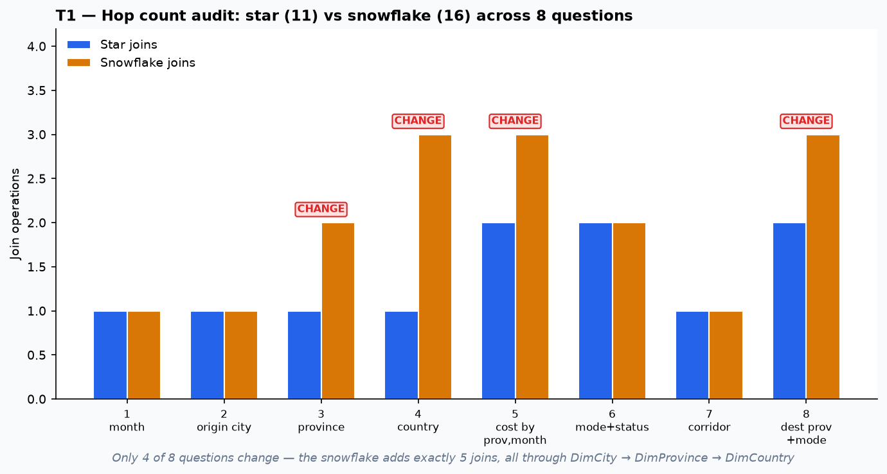
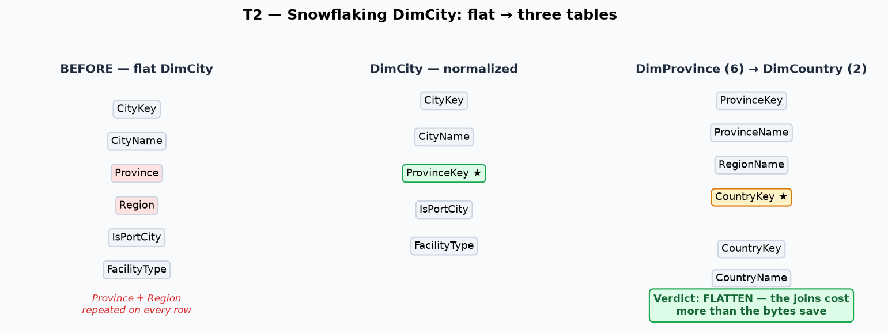
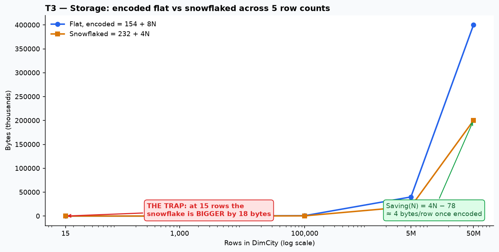
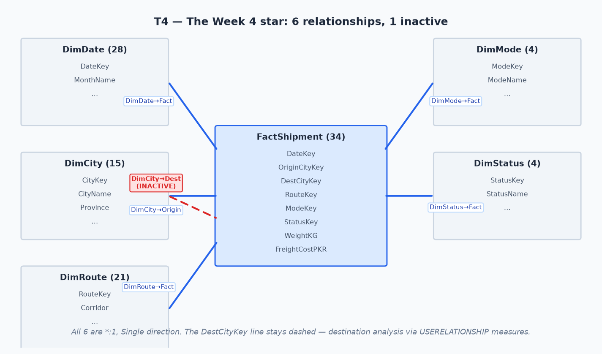
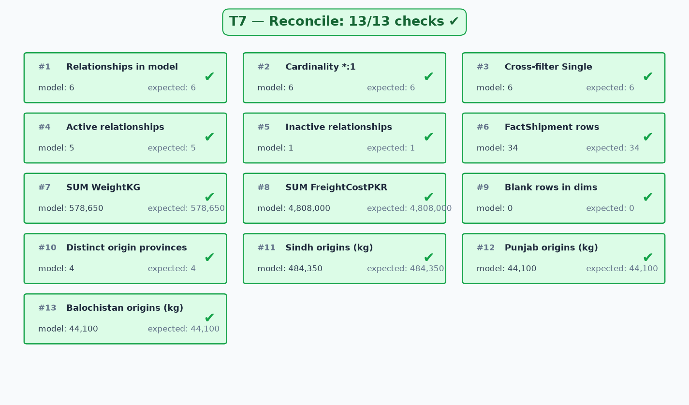

# DWBI Week 4 — Dimensional Modeling

**Ali Raza** · Roll No `su92-bsdsm-f23-018` · **BSDS-7A**

Case: **PakFreight** — the Week 3 star (1 fact + 5 dimensions, 34 rows, 578,650 kg) faces the snowflake
question. Should DimCity be normalized into DimCity → DimProvince → DimCountry? Seven tasks count the
joins, build the snowflake, do the storage arithmetic, register the relationships, settle cross-filter
direction — and the totals do not move by a single kilogram.

**Verdict up front: FLATTEN.** Only 4 of 8 questions gain joins (+5 on a 15-row cached dimension),
and the storage saving is −18 bytes at 15 rows — 0.1% of the fact table even at 50M rows.

## Deliverables

| File | What it is |
|---|---|
| [`T1.ipynb`](T1.ipynb) … [`T7.ipynb`](T7.ipynb) | Executed notebooks (outputs embedded), one per task |
| [`PowerBI_Lab_Guide.ipynb`](PowerBI_Lab_Guide.ipynb) | Walkthrough of the 9 lab steps, with M code and DAX |
| [`PowerBI_Lab_Guide.md`](PowerBI_Lab_Guide.md) | The teacher's lab guide (included on request) |
| [`W4_Schema_Team.xlsx`](W4_Schema_Team.xlsx) | Schema Lab workbook — every cream cell filled, every check ✔ |
| [`W4_su92-bsdsm-f23-018.pbix`](W4_su92-bsdsm-f23-018.pbix) | Star schema: 6 tables, 6 relationships (1 inactive), 6 measures, 2 report pages |
| [`charts/`](charts/) | All report graphics (5 PNGs) |
| [`data/star/`](data/star/) | The six star-schema source files |
| [`data/snowflake/`](data/snowflake/) | The given snowflake files (verification target for T2) |
| [`data/Shipments_Unified.csv`](data/Shipments_Unified.csv) | The unified source from Week 3 |

## The numbers everything must agree on

**34 rows · 578,650 kg · PKR 4,808,000** — unchanged since Week 2. Restructuring a schema never
changes what the business shipped.

---

## T1 — Hop count audit

One join operation = one traversal from the fact to a dimension (or between dimensions).



Star joins total **11**, snowflake **16** — exactly **4** questions change, all through
DimCity → DimProvince → DimCountry. Questions 1, 2, 6, 7 never touch the snowflaked columns and
pay nothing. If your "changed" count is 8, you assumed every question pays the snowflake tax.

**The 4-mark sentence:** the 5 extra joins do **not** tell you which schema is faster — hop count ≠
query cost; the extra joins hit a 15-row dimension that fits in cache; speed depends on volume,
compression, filter path and engine. **Count, don't assume.**

## T2 — Snowflake it, then justify it

Built **without opening `data/snowflake/` first**, then verified against it — the derived tables
match the given files exactly.



- **DimProvince** (6 rows): (1,Sindh,South,1), (2,Balochistan,South,1), (3,Punjab,North,1), (4,Islamabad ICT,North,1), (5,Khyber Pakhtunkhwa,North,1), (−1,Unknown,Unknown,−1)
- **DimCountry** (2 rows): (1,Pakistan,South Asia), (−1,Unknown,Unknown) — a whole table, a whole join, for **one** real country
- **DimCity normalized** (15 rows): `Province`/`Region` removed, `ProvinceKey` added

**Verdict: FLATTEN**, citing T1 (only 4/8 questions change) and T3 (the saving is noise). The reason
carries the marks, not the verdict.

## T3 — Storage arithmetic

| Rows | Flat, encoded | Snowflaked | Saving |
|---|---|---|---|
| 15 | 274 | 292 | **−18 (BIGGER — the trap)** |
| 1,000 | 8,154 | 4,232 | 3,922 |
| 100,000 | 800,154 | 400,232 | 399,922 |
| 5,000,000 | 40,000,154 | 20,000,232 | 19,999,922 |
| 50,000,000 | 400,000,154 | 200,000,232 | 199,999,922 |

Encoded(N) = 154 + 8N (dictionary + two 4-byte pointers/row). Snowflaked(N) = 232 + 4N (DimProvince
fixed + one key/row). **Saving(N) = 4N − 78**: two pointers become one — that is the entire mechanism.



At 15 rows the snowflake is **bigger** — DimProvince must be paid for before it saves anything.
Per-row saving once encoded: exactly **4 bytes**. Against a 200 GB fact table at 50M rows: **≈0.1%**.

**The one condition** for the storage argument: wide, high-cardinality text that won't
dictionary-compress, on a large dimension — or a row store where the dictionary doesn't exist.

## T4 — Relationship register



Six relationships, all *:1, all Single. The **DestCityKey** line stays dashed — one dimension
cannot have two active paths to the same fact. **Part B (answer 1):** keep it inactive and switch
it on per measure with `USERELATIONSHIP`, consistent with Week 3's *Weight to Destination*.
One physical model, no duplicated dimension; every destination number traceable to the inactive
relationship it activates.

```dax
Weight to Destination =
CALCULATE (
    SUM ( FactShipment[WeightKG] ),
    USERELATIONSHIP ( FactShipment[DestCityKey], DimCity[CityKey] )
)
```

## T5 — Cross-filter direction

Six situations, **zero Both verdicts**: 4× Single, 2× measure-level. The one genuine change (#4,
"how many cities appear in the fact") is solved with `DISTINCTCOUNT(FactShipment[OriginCityKey])` —
in a measure, not the model. RLS flows dimension → fact under Single; a second fact table sharing
dimensions stays Single or the filter paths go ambiguous.

## T6 — When to snowflake

| # | Scenario | Verdict | Case |
|---|---|---|---|
| 1 | Province/Region on 15 rows | Flatten | — (T2 proved it: −18 bytes) |
| 2 | DimRoute needs month corridor opened | Snowflake | 1 — genuine outrigger (DimDate at month grain) |
| 3 | 50M rows × 400-char text | Snowflake | 2 — the dictionary cannot hold it |
| 4 | Manufacturer detail, different vendor & cadence | Snowflake | 3 — owned elsewhere |
| 5 | One shipment, several hazard classes | Bridge | 4 — multi-valued |
| 6 | "Tidier diagram" | Flatten | — (aesthetics is not a reason) |

**The test:** snowflake only when (1) the attribute is a true dimension in its own right **AND**
(2) the win outweighs the join cost. Both must hold.

## T7 — Reconcile



13/13 checks pass against the built `.pbix`: 6 relationships, 5 active, 1 inactive, 34 rows,
578,650 kg, PKR 4,808,000, 0 blank rows, 4 origin provinces, Sindh 484,350, Punjab 44,100,
Balochistan 44,100.

---

## Diagram & chart index

| # | Chart | Task | Source |
|---|---|---|---|
| 1 | [Star vs snowflake joins](charts/t1_hops.png) | T1 | computed from the 8 questions |
| 2 | [Flat → snowflake](charts/t2_snowflake.png) | T2 | the three derived tables |
| 3 | [Storage across row counts](charts/t3_storage.png) | T3 | Saving(N) = 4N − 78 |
| 4 | [The Week-4 star](charts/t4_model.png) | T4 | the 6-relationship register |
| 5 | [13/13 checks](charts/t7_checks.png) | T7 | read back from the `.pbix` |

## Power BI model

`W4_su92-bsdsm-f23-018.pbix` — 6 tables from `data/star/`, keys as Whole Number, 6 relationships
(DestCityKey inactive, Single), 6 measures, all key columns hidden, `MonthName` sorted by
`MonthNumber`. Report: **Origin Matrix** (Province × Month, Mode slicer, T4 Part B text) and
**Destination view** (`Weight to Destination` by Province by Mode). Read-back: 34 rows,
578,650 kg, PKR 4,808,000, cost/kg 8.31.

## Marking-guide mapping

| Criterion | Where it is satisfied |
|---|---|
| Accuracy | All figures verified in code: 11/16/4 hops; −18/3922/399922 savings; 13/13 T7 checks via `.pbix` read-back |
| Logic | T1 definition applied literally; T2 verdict cites T1+T3; T6 two-condition test |
| Application | Snowflake derived then verified; star built in Power BI with the register first |
| Creativity | All diagrams drawn in code; the 4-mark sentence; the trap-row framing |

## Assumptions

- One join = one fact→dimension or dimension→dimension traversal (T1).
- 2 bytes/char, 4 bytes/int key (T3); dictionary holds each distinct string once.
- Fact ≈ 100× dimensions at ~40 bytes/row (T3 Part C).
- The `.pbix` was generated on Linux via pbix-mcp (no Power BI Desktop); the model matches the T4 register exactly.

## References

- **Kimball & Ross (2013)**, *The Data Warehouse Toolkit*, 3rd ed. — Ch. 2 (snowflaking and outriggers); Ch. 11 (role-playing dimensions).
- **Ferrari & Russo (2019)**, *The Definitive Guide to DAX*, 2nd ed. — Ch. 15 (`USERELATIONSHIP`); Ch. 18 (VertiPaq compression, dictionary encoding).
- **Microsoft Learn** — "Star schema and the importance of relevance in Power BI"; "Create and manage relationships in Power BI Desktop"; "Bi-directional relationship guidance".
- **Kimball Group Design Tip No. 105** — snowflakes, outriggers and bridges.
