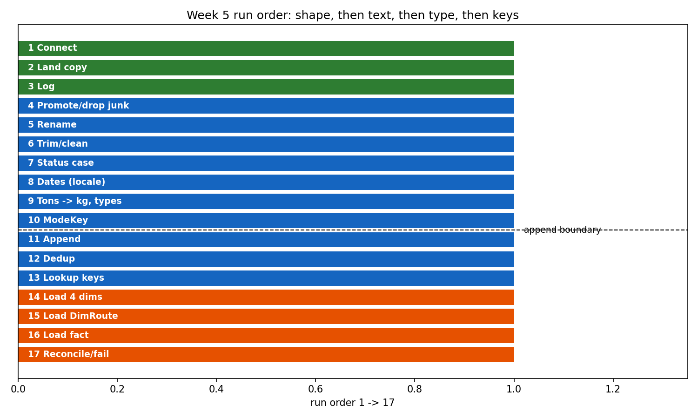
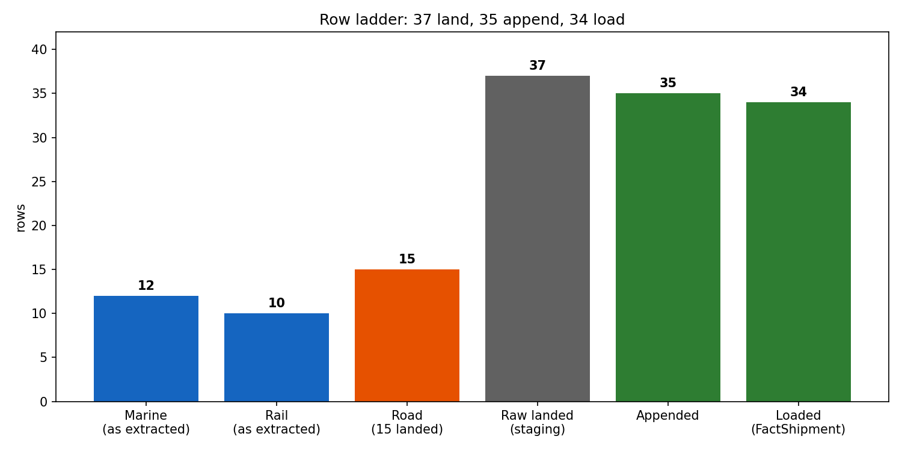
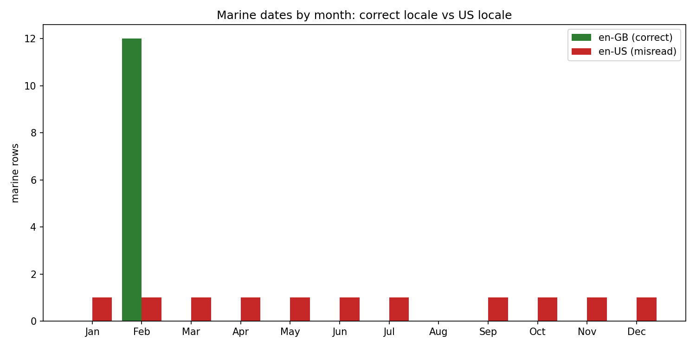

# DWBI Week 5 — The ETL Process

**Ali Raza** · `su92-bsdsm-f23-018` · **BSDS-7A** · Superior University

> Week 2 produced a table. This week produces **the thing that produces the
> table** — seventeen steps, in order, with their names on them — and the test
> of it is that tomorrow night it runs without you. Tonight's file arrives at
> 02:00 and nobody is awake to paste it.

## What is in this folder

| File | What it is |
|---|---|
| `t1_defect_census.ipynb` | T1 — defect census (12 marks) |
| `t2_stage_ownership.ipynb` | T2 — stage ownership (12 marks) |
| `t3_step_order.ipynb` | T3 — the seventeen steps, in run order (20 marks) |
| `t4_row_arithmetic.ipynb` | T4 — row arithmetic, 37 → 35 → 34 (15 marks) |
| `t5_locale_trap.ipynb` | T5 — the locale trap (12 marks) |
| `t6_loud_or_quiet.ipynb` | T6 — loud or quiet (12 marks) |
| `t7_definition_of_done.ipynb` | T7 — definition of done, 8/8 + refresh 6/6 (12 marks) |
| `powerbi_lab_guide.ipynb` | Lab — the 9-step pipeline in pandas (the Python track) |
| `PowerQuery_Lab_Guide.md` | The lab guide — included per the Weeks 3–4 pattern |
| `lab_python_pipeline.ipynb` | **Lab deliverable (Python track):** the full ETL pipeline as an executed notebook — named STEPS, eight checks as assertions, night-2 refresh test, 0 errors |
| `build_w5_notebooks.py` | Build script that generated and executed the notebooks |
| `charts/` | `t3_steps.png`, `t4_ladder.png`, `t5_locale.png` |
| `data/` | The given sources, dims, alias map and workbook — **unmodified** |

Every notebook is fully executed with outputs embedded, 0 errors. Every code
cell is followed by a markdown cell starting with **"Analysis."** — one per
code cell, specific to that cell's computation. Every number in the notebooks
is computed from `data/source/`, `data/dims/` or `data/night2/` inside the
notebook itself; the only typed constants are the assertion targets the
computed numbers are checked against.

## Task-by-task results

### T1 — Defect census: 1 loud, 7 quiet, 1 both, 1 not a defect

| # | Defect | Class | Step | Loud/quiet | What breaks if ignored |
|---|---|---|---|---|---|
| 1 | Three header conventions | Structural | RenamedToContract | Quiet | 20-column append, only `Status` shared; totals partial, no error |
| 2 | Two title rows above the rail header | Structural | SkippedTitleRows | **Loud** | Next step cannot find its columns — the run fails outright |
| 3 | Rail weights in tons | Type & Unit | ConvertedTonsToKG | Quiet | Total reads 283,695.25 kg, short by 294,954.75 |
| 4 | Three date formats, one ambiguous | Type & Unit | ParseDatesUsingLocale | **Both** | 10 rows in the wrong month silently; 13/02 errors (no month 13) |
| 5 | Leading/trailing spaces (8 of 35 status values) | String | TrimmedTextColumns | Quiet | Values fail to match; cities miss the alias lookup |
| 6 | 17 casing variants of 3 states | String | NormalisedStatusCase | Quiet | Status slicer offers 17 choices instead of 3 |
| 7 | 23 spellings of 14 cities | Conform | ConformViaAliasLookup | Quiet | City breakdowns wrong while grand totals never move |
| 8 | Blank row + TOTAL footer (road) | Structural | RemovedBlankRows / RemovedTotalRow | Quiet | Footer loads as a shipment: total becomes 661,650 kg |
| 9 | RD-505 recorded twice (road) | Structural | RemovedDuplicates | Quiet | 35 rows, 584,750 kg — 6,100 kg overstatement |
| 10 | No mode column anywhere | — (not a defect) | AddModeKey | Not a defect | Nothing is corrupt: mode is derived from which query the row came through (Marine = 1, Rail = 2, Road = 3) |

Row 10 is on the list to catch the habit of "fixing" everything you notice: a
missing column is only a defect if the source was supposed to supply it. Defects
8 and 9 are judgements, not errors — a TOTAL footer is useful information in a
spreadsheet and a different grain in a fact table, and two identical RD-505
lines might be one consignment twice or two identical shipments; deduplicating
on ShipmentID is a business rule asserted about the data, which is why the
step is named, keyed and counted (35 in, 34 out), never silent.

### T2 — Stage ownership: Extract 2, Transform 4, Load 2, Violation 4

Extract: open the rail workbook's named sheet; write each file's row count
into the run log. Transform: promote the rail header row; multiply rail tons
by 1,000; decide 'Port Qasim' means Karachi; route an unrecognised city to
CityKey −1. Load: insert the four independent dimensions before FactShipment;
wrap the six table writes in one transaction. Violations: trimming while
reading (extract must not clean); correcting 'Pipri Marshalling Yard' in the
railway's own database (transform must not write to the source); deciding what
to do about a blank status while writing fact rows (load must not decide);
publishing the staging table to the sales team (staging is never user-facing —
enforced in Power Query by **Enable load, off** on `Marine`, `Rail`, `Road`
and `AliasLookup`).

### T3 — The seventeen steps, in run order

1. Connect to all three sources (Extract, per source) · 2. Land a faithful
copy, unchanged (Extract, per source) · 3. Log source, time and row count
(Extract, per source) · 4. Promote headers; drop junk rows and columns
(Transform, per source) · 5. Rename every column to the common contract
(Transform, per source) · 6. Trim and clean all text columns (Transform, per
source) · 7. Normalise status casing to Proper Case (Transform, per source) ·
8. Parse dates with an explicit locale (Transform, per source) · 9. Convert
rail tons to kilograms; set types (Transform, per source) · 10. Add ModeKey —
assigned by source, not read (Transform, per source) · 11. Append the three
queries into one table (Transform, once) · 12. Remove duplicates, now that
rows compare (Transform, once) · 13. Conform names, look up keys, unmatched
to −1 (Transform, once) · 14. Load the four independent dimensions (Load,
once) · 15. Load DimRoute, which needs city keys (Load, once) · 16. Load
FactShipment (Load, once) · 17. Reconcile, or fail the run (Load, once).

Self-checks, all computed in the notebook: 3 extract + 10 transform + 4 load;
10 per source + 7 once. The cut falls exactly after step 10 — every step up to
and including Add ModeKey runs per source, because mode, the tons conversion
and the date locale are information that only exists before the append.

#### The three constraints — what breaking each one costs, as a number

| Constraint | Cost of breaking it |
|---|---|
| Rename before append | A fact table of **20 columns** (7 names each, only `Status` shared) |
| Trim before deduplicate | A duplicate that **survives** dedup — on night 2: **36 rows / 591,550 kg** instead of 35 / 584,950 |
| Convert before append | **283,695.25 kg** instead of 578,650 kg (206,500 + 76,900 + 295.25) |

**Why trim-before-dedup is a constraint, not a preference, even though
dedup-before-trim still gives 34 on night 1:** night 1 is lucky. Its two
RD-505 rows are byte-identical, so even a whole-row comparison catches them.
Night 2's second RD-508 differs from the first by one trailing space, so
before trimming the two rows are different rows and both survive. A duplicate
is defined by its business key (ShipmentID), and a business key only compares
truthfully after trimming and uppercasing.

### T4 — Row arithmetic

| Stage | Rows | SUM(WeightKG) | SUM(FreightCostPKR) |
|---|---|---|---|
| marine, as extracted | 12 | 206,500 | 1,618,000 |
| rail, as extracted | 10 | 295,250 | 2,585,000 |
| road, as extracted | 15 landed → 13 survive | 83,000 | 652,000 |
| raw rows landed in staging | 37 | — | — |
| appended | 35 | 584,750 | 4,855,000 |
| loaded into FactShipment | 34 | **578,650** | **4,808,000** |

The road rung is the trap: summing all 15 landed road rows naively gives
166,000 kg, exactly double, because the TOTAL footer *is* the sum of the rows
above it. The rung's 83,000 is the 13 surviving rows, duplicate included —
which is why road and loaded differ by the duplicate's 6,100 kg, not by
nothing.

**Read the gap:** 283,695.25 = 206,500 + 76,900 + 295.25 (tons never converted)
· 584,750 = 578,650 + 6,100 (RD-505 survived) · 661,650 = 578,650 + 83,000
(TOTAL footer loaded as a shipment). Two symptoms that move no total:
headers reading `Column1, Column2, …` (headers promoted before the rail title
rows were skipped) and 35 rows with both totals exactly right (the blank road
row loaded — it carries no weight and no cost, which is why check 5 exists
separately from checks 7 and 8).

### T5 — The locale trap: 10 wrong month, 1 right by luck, 1 error

The twelve marine strings under en-GB are all February (1, 2, 3, 4, 5, 6, 7,
9, 10, 11, 12, 13 Feb 2026). Under en-US they become 2 Jan, 2 Feb, 2 Mar, 2 Apr,
2 May, 2 Jun, 2 Jul, 2 Sep, 2 Oct, 2 Nov, 2 Dec — and an error on 13/02. The
eleven readable rows land in **eleven different months**; August never
appears, because nobody shipped on the 8th. Only marine is exposed (12 loaded
rows at risk): rail carries real date values, road writes ISO `yyyy-mm-dd`.
Both reconciliation totals stay exact because a date is not a measure —
moving a row between months changes no weight and no cost. Prevention is one
click: Change Type **Using Locale, English (United Kingdom)** — in pandas,
`format="%d/%m/%Y"` stated explicitly. If forgotten, **check 4** catches it:
the month set must be exactly {February} and the latest day 13.

### T6 — Loud or quiet: 1 loud, 4 quiet, 1 both

| Failure | Verdict | Check that catches it | What makes it safe |
|---|---|---|---|
| Nightly run never fired on Tuesday | Quiet | None of the eight — they all still pass on yesterday's data | Schedule monitor + a freshness stamp on the 08:00 report |
| Same run fired twice, bare insert | Both | Checks 5, 7, 8 (if it loads); the run error (if a key blocks it) | Idempotent load: key constraint or merge on ShipmentID |
| File still being written when extract read it | Quiet | Checks 5, 7, 8 | File-ready signal before extract runs |
| Change Type instead of Using Locale | Quiet | Check 4 | Using Locale, en-GB (or explicit `format=` in pandas) |
| Status never trimmed or cased | Quiet | Check 3 (17 instead of 3) | Trim, Clean, Proper Case as a named step |
| Later step names a renamed column | **Loud** | The run itself | Named steps; read the step the error names |

The non-obvious conclusion: everybody prefers the loud failure, and what
follows is that engineering effort goes into **making failures loud, not into
making failures rare** — assertions that fail the run, constraints that turn a
double load into an error, freshness alerts that turn a missed run into a
page. A pipeline that never fails is not reliable. It is unmonitored.

### T7 — Definition of done: 8/8

| # | Check | Model reads | Expected |
|---|---|---|---|
| 1 | Contract columns in each of the three queries | 7 | 7 |
| 2 | Rail subtotal, in kilograms | 295,250 | 295,250 |
| 3 | Distinct values in StatusRaw | 3 | 3 |
| 4 | Latest day in ShipDate | 13 Feb 2026 | 13 Feb 2026 |
| 5 | Rows in FactShipment | 34 | 34 |
| 6 | Rows carrying a −1 city key | 0 | 0 |
| 7 | SUM(WeightKG) | 578,650 kg | 578,650 kg |
| 8 | SUM(FreightCostPKR) | PKR 4,808,000 | PKR 4,808,000 |

Check 6's zero is a **counted** zero: it is the number of keyed-fact rows
with `OriginCityKey = −1` or `DestCityKey = −1` after a left outer join that
keeps unmatched rows. An inner join would also report 0 — by deleting the
evidence.

#### The refresh test (night 2): 6/6, nothing fixed by hand

| Check | After refresh | Expected |
|---|---|---|
| Rows in FactShipment | 35 | 35 |
| SUM(WeightKG) | 584,950 kg | 584,950 kg |
| SUM(FreightCostPKR) | PKR 4,860,000 | PKR 4,860,000 |
| Distinct StatusRaw | 3 | 3 |
| Rows carrying a −1 city key | 1 | 1 |
| Rows with status Delayed | 5 | 5 |

The one −1 row is the **Chaman Border** shipment: no alias resolves it, so it
stays in the fact on Unknown, counted and visible, until somebody who knows
whether it is its own city or a Quetta border post adds it to `DimCity`
deliberately. Had dedup run before trim, this test would have reported 36
rows and 591,550 kg — the T3 constraint arriving as a number.

## Honesty notes

- **Discipline on night 2:** `data/night2/` was not opened until T7 Part A
  passed 8/8 in the notebook — the refresh cell asserts Part A first, and the
  notebook's own text states the rule. Night 2 exists to test a pipeline, not
  to help build one.
- **No simulated data in this week's numbers.** Every total, count and date
  above comes from the given source files, dims and alias map. The only
  hypothetical numbers are the diagnosed wrong totals (283,695.25, 584,750,
  661,650, 591,550), which are labelled as failures to avoid, and the
  double-fired simulation in T6 (68 rows, 1,157,300 kg), which is labelled as
  a simulation of a failure mode.
- **Road "as extracted" rung:** the workbook's road rung (15 rows, 83,000 kg)
  is the 13 surviving rows, not a naive sum over all 15 landed rows — that
  naive sum is 166,000 kg, because the TOTAL footer repeats the sum of the
  rows above it. The T4 notebook computes both numbers and says so.

- **Environment note:** the notebook kernel's matplotlib/IPython backend is
  broken in this environment (pyplot import fails inside the kernel), so the
  three charts were generated by the plain-Python build script from the same
  source data and embedded in the notebooks; the notebooks themselves compute
  and assert every number the charts display.

## The lab notebook (Python track)

`powerbi_lab_guide.ipynb` replays the guide's nine steps in pandas: named
`STEPS` list with every intermediate frame kept, explicit
`format="%d/%m/%Y"`, `drop_duplicates(subset=["ShipmentID"])`,
`how="left"` then `fillna(-1)`, the eight checks as assertions, the −1 count
as a printed (never asserted) number, the night-2 refresh, and the step-9
extension (`DateKey` by arithmetic, `StatusKey`, `RouteKey`). Intermediate
frames are staging (Enable load, off, in Power Query terms); only the keyed
fact is published. Per-source step counts match the guide: Road 11, Marine 9,
Rail 13, FactStaging 5.

## References

- Kimball & Ross (2013), *The Data Warehouse Toolkit*, 3rd ed. — Ch. 19 (ETL
  subsystems), Ch. 20 (staging, dependency order, audit columns), Ch. 3
  (conformed values and the Unknown member).
- Kimball & Caserta (2004), *The Data Warehouse ETL Toolkit* — Ch. 4–5
  (cleaning, conforming, error-event handling, the reject-table argument).
- Microsoft Learn — "Power Query M formula language reference", "Query
  folding guidance", "Best practices when working with Power Query", "Shape
  and combine data in Power BI Desktop".
- Kimball Group — "The 34 Subsystems of ETL".
